<picture>
  <source media="(prefers-color-scheme: dark)" srcset="assets/terminal-dark.svg">
  
</picture>

  <a href="https://lucasrikelmi.dev">lucasrikelmi.dev</a> ·
  <a href="https://www.linkedin.com/in/lucasrikelmi">LinkedIn</a> ·
  <a href="mailto:lucas@lucasrikelmi.dev">lucas@lucasrikelmi.dev</a>

<picture>
  <source media="(prefers-color-scheme: dark)" srcset="assets/h-sobre-dark.svg">
  
</picture>

<picture>
  <source media="(prefers-color-scheme: dark)" srcset="assets/sobre-dark.svg">
  
</picture>

<picture>
  <source media="(prefers-color-scheme: dark)" srcset="assets/h-projetos-dark.svg">
  
</picture>

  <a href="https://github.com/LucasRikelmi/candeia"><picture><source media="(prefers-color-scheme: dark)" srcset="assets/projeto-1-dark.svg"></picture></a>
  <a href="https://dados.lucasrikelmi.dev"><picture><source media="(prefers-color-scheme: dark)" srcset="assets/projeto-2-dark.svg"></picture></a>
  <a href="https://lucasrikelmi.dev"><picture><source media="(prefers-color-scheme: dark)" srcset="assets/projeto-3-dark.svg"></picture></a>
  <a href="https://github.com/LucasRikelmi/lucasrikelmi.dev/tree/main/lab/cpu"><picture><source media="(prefers-color-scheme: dark)" srcset="assets/projeto-4-dark.svg"></picture></a>

<picture>
  <source media="(prefers-color-scheme: dark)" srcset="assets/h-stack-dark.svg">
  
</picture>

<picture>
  <source media="(prefers-color-scheme: dark)" srcset="assets/stack-dark.svg">
  
</picture>

<picture>
  <source media="(prefers-color-scheme: dark)" srcset="assets/h-contribuicoes-dark.svg">
  
</picture>

<picture>
  <source media="(prefers-color-scheme: dark)" srcset="https://raw.githubusercontent.com/LucasRikelmi/LucasRikelmi/output/contribuicoes-dark.svg">
  
</picture>

<picture>
  <source media="(prefers-color-scheme: dark)" srcset="assets/rodape-dark.svg">
  
</picture>
